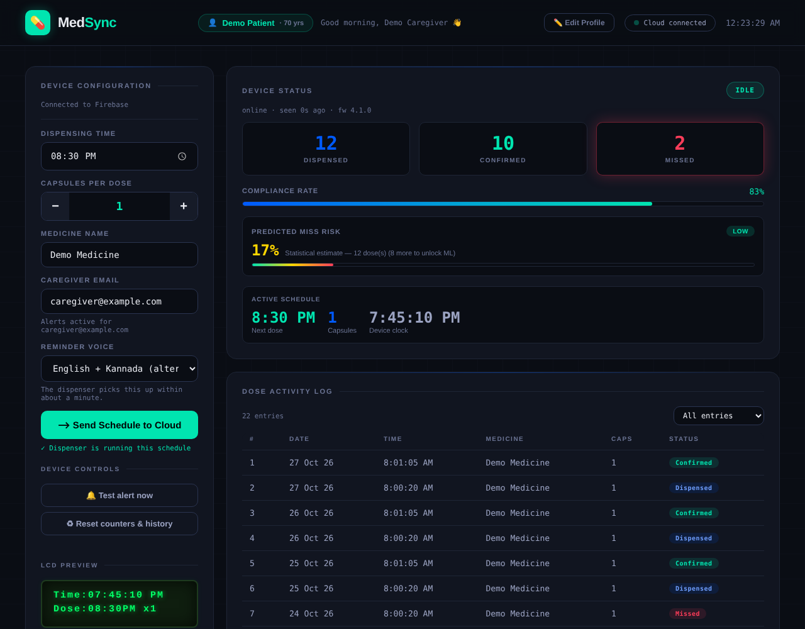
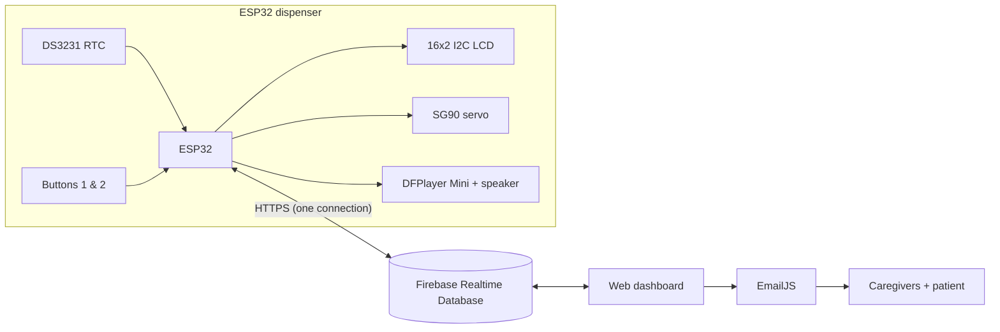

# MedSync — IoT Smart Medicine Dispenser

MedSync is an ESP32-based medicine dispenser that reminds a patient by voice (English and Kannada), dispenses the dose with a servo, asks the patient to confirm intake, and syncs every event to a cloud dashboard. Caregivers and the patient are e-mailed when a dose is missed, and when the dashboard predicts a high chance that the next dose will be missed.

Final-year project, Department of Electronics and Communication Engineering, SJCIT Chickballapur (VTU).
**Team:** Nischitha M (1SJ23EC113), Pavithra K V (1SJ23EC121), Srinath Gupta (1SJ23EC162) · **Guide:** Dr. Deepthi Prakash

*Dashboard shown with fictional demo data.*

---

## Features

- **Scheduled reminders** from a battery-backed real-time clock (DS3231), corrected from internet time when online.
- **Voice prompts** through a DFPlayer Mini: English, Kannada, or both alternately (chosen on the dashboard).
- **Two-step confirmation:** Button 1 dispenses, Button 2 confirms the dose was taken. No confirmation within the time window → missed dose.
- **Works offline:** alarms, voice and dispensing run without Wi-Fi; events are stored in flash and uploaded when the connection returns.
- **Live dashboard** (single HTML page): device status, online/offline heartbeat, schedule sync confirmation, dose log, 7-day chart, compliance rate.
- **Notifications:** missed-dose e-mail and high-risk heads-up e-mail to both caregivers and the patient (EmailJS), sent exactly once per event.
- **Miss-risk prediction:** a Bayesian estimate for small histories, and an in-browser logistic-regression model (TensorFlow.js) once 20 real doses are logged.
- **Demo controls:** "Test alert now" and "Reset counters & history" buttons on the dashboard.

## Architecture

| Firebase path | Written by | Contents |
|---|---|---|
| `device/schedule` | dashboard | `hour`, `minute`, `doseCount`, `med` |
| `device/status` | device (every 10 s) | state, clock, active schedule, voice mode, health flags, `lastSeen` (server time) |
| `device/history/<doseId>_<status>` | device | one row per event: `dispensed`, `confirmed`, `missed`, `prealert` |
| `device/log` | device | device counters |
| `device/prediction` | dashboard | `riskScore`, `riskLevel` (LOW / MEDIUM / HIGH) |
| `device/voice` | dashboard | `mode`: `en`, `kn`, `both` |
| `device/command` | dashboard | `test_alert` or `reset_counters` |
| `device/alerts/<key>` | dashboard | marks an e-mail as sent (prevents duplicates) |
| `device/settings` | dashboard | patient and caregiver profile |

## Hardware

| Part | ESP32 pin |
|---|---|
| LCD (PCF8574 backpack) + DS3231 — SDA / SCL | GPIO 21 / GPIO 22 |
| Servo signal (servo powered from 5 V, common GND) | GPIO 13 |
| DFPlayer TX → ESP32 RX2 | GPIO 16 |
| ESP32 TX2 → 1 kΩ → DFPlayer RX | GPIO 17 |
| Button 1 (dispense), other leg to GND | GPIO 18 |
| Button 2 (confirm), other leg to GND | GPIO 19 |

Power from a 5 V supply rated at least 2 A, with a 1000 µF capacitor across the 5 V rail. Speaker on DFPlayer `SPK_1`/`SPK_2` (never to GND).

## Setup

### 1. Firmware
1. Arduino IDE with **esp32 by Espressif** (tested API set: core 3.3.x) and these libraries: *Firebase Arduino Client Library for ESP8266 and ESP32* (Mobizt, 4.4.x), *RTClib*, *LiquidCrystal_I2C*, *ESP32Servo*, *DFRobotDFPlayerMini*.
2. In `firmware/medsync_firmware/`, copy `secrets.h.example` to `secrets.h` and fill in your Wi-Fi networks and Firebase project. `secrets.h` is ignored by git.
3. Board **ESP32 Dev Module**, **Partition Scheme → Huge APP (3MB No OTA/1MB SPIFFS)** (the program is larger than the default 1.2 MB).
4. Upload. Serial Monitor at 115200: `t` = test alert, `s` = status, `r` = reset counters.

Before the main firmware, `bench_test/bench_test_all_parts` checks every part on its own (I2C scan, LCD, RTC, voice, servo, buttons).

### 2. SD card
FAT32 card with a folder named `mp3` containing the files from `sd_card/mp3/`:

| File | Clip |
|---|---|
| 0001–0004 | English: alert, please confirm, confirmed, missed |
| 0005, 0007–0009 | Kannada: alert (with "press Button 1"), press Button 2, confirmed, missed |
| 0010 / 0011 | English / Kannada: "your medicine is due in 10 minutes" (0010 is text-to-speech) |

### 3. Firebase
1. Create a project with a **Realtime Database** and enable **Anonymous** sign-in (and optionally Email/Password for the device).
2. Paste `firebase/database.rules.json` into *Realtime Database → Rules* and publish.
3. Put your web config into the `firebaseConfig` block of `dashboard/index.html`.

### 4. E-mail (EmailJS)
Create a service and a template. In the template set **To Email** `{{to_email}}`, **Subject** `{{subject}}` and the body `{{message}}`. Put the service ID, template ID and public key into `dashboard/index.html`. In EmailJS, restrict sending to your dashboard's web address.

### 5. Dashboard
Open `dashboard/index.html` through a local web server (for example the VS Code *Live Server* extension), or publish it with **GitHub Pages**: *Settings → Pages → Deploy from a branch → main / root*. The dashboard is then at `https://<user>.github.io/<repo>/dashboard/`.

## Prediction model and synthetic data

The dashboard predicts the chance that the next dose is missed. With fewer than 20 logged doses it uses a smoothed (Bayesian) miss rate with a same-weekday pool and a recent-streak boost; from 20 doses it trains a one-layer logistic-regression model in the browser on six features (time of day and weekday as sine/cosine, running miss rate, current miss streak).

`synthetic_study/` contains a **synthetic** evaluation: 20 simulated patients × 90 days × 2 doses (3,600 records, 15 % missed) generated with known, planted rules. On a chronological per-patient 80/20 split the logistic regression reached ROC-AUC 0.644 (seed 42; 0.644–0.767 across four seeds) against 0.589 for the heuristic and 0.664 for an oracle that knows the true probabilities. **These numbers show that the model can recover planted patterns. They are not a measure of real-world accuracy, and the system has not been clinically validated.**

## Limitations

- E-mails are sent by an open dashboard tab (EmailJS runs in the browser). Server-side sending would need a paid Firebase plan (Cloud Functions).
- Anonymous sign-in means anyone with the dashboard link can use it; the database rules validate the data but do not separate users.
- The dispensing mechanism is a prototype; capsule jams are not detected.
- Real-use data so far comes from bench testing, not from patients.
